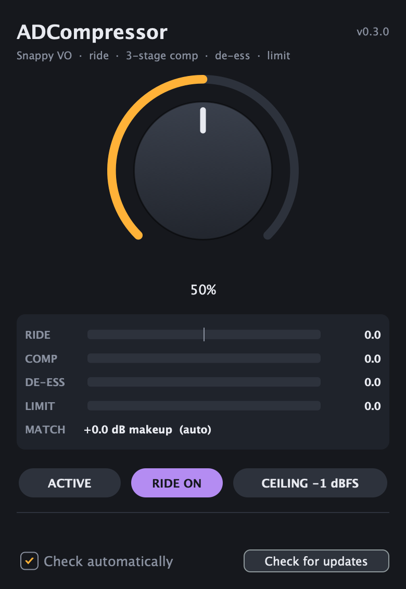

# ADCompressor

A **single-knob voice-over compressor** for a snappy, upfront, broadcast-style voice. It is available as a VST3 on all platforms, plus an AU on macOS.



Turn one knob and ADCompressor runs your voice through three compression stages, a
line-to-line level rider, a presence lift, a de-esser and a brickwall limiter, all scaled together. The output is
**automatically loudness-matched to the input**, so turning the knob (or bypassing the plugin) changes the
*sound*, not the volume. That makes A/B comparisons honest. You hear what the processing does,
not "louder sounds better".

It works the same on hot and conservatively recorded takes: the plugin measures how loud the
voice is coming in and adapts, so you don't need to gain-stage into it.

## The knob

| Amount | What you get |
|--------|--------------|
| 0%     | Transparent (only the safety limiter can act) |
| 25–50% | Gentle leveling and a little extra snap and presence: a natural, polished voice |
| 75–100% | Dense, forward, "radio" voice: tight level, lines ridden even, punchy consonants, sibilance kept in check |

**Ceiling** switches the output limiter between **−1 dBFS** (default) and **−6 dBFS**. Use −6 if
your delivery spec asks for peaks at or below −6 and your takes are recorded with some headroom
(peaks around −10 dBFS or lower), where it barely engages. On hot takes it will audibly squash
consonants. Note that this is a sample-peak limiter: if your spec is in dBTP (true peak), keep a
true-peak limiter on your final mix as well.

**Ride** (on by default) switches the slow line-to-line rider on or off. Turn it off to keep the
natural level differences between lines (the compressors, de-esser and limiter still work as
usual, and the loudness match is unchanged). The switch glides over 200 ms, so you can flip it
during playback.

Double-click the knob to return to 50%. **Bypass** (also linked to your DAW's bypass) crossfades
over 20 ms to a time-aligned dry signal, so A/B switching is click-free. The meters show the rider's gain
(**RIDE**, from the centre: right lifts, left cuts), gain reduction for **COMP** (all three compressor
stages), **DE-ESS** and **LIMIT**, plus the current makeup gain.

## What happens inside

| Stage | Role | At 0% → 100% |
|-------|------|--------------|
| Input reference | Brings any take to about −18 LUFS internally (speech-only measurement), then removes that gain exactly at the output. It's never heard; it just makes the knob behave the same at any recording level | — |
| 1. Leveler | RMS, 15 ms attack / 180 ms release, 10 dB soft knee, **20 ms lookahead**: evens out phrase-to-phrase level | ratio 1:1 → 3.5:1 |
| 2. Snap compressor | Peak, **3 ms attack** lets consonant onsets through before clamping, 60 ms release: the "snap" | ratio 1:1 → 6:1 |
| 3. Peak catcher | 20:1, 0.3 ms attack, a few dB above stage 2: trims the transients stage 2 let through | off → on |
| Rider | Evens out line-to-line level like a fader ride. Compares the compressed level over the last ~200 ms of speech with the long-term average and glides toward the difference (80 ms). Holds still between lines, so gaps don't pump and room tone isn't lifted | off → full, within ±6 dB (**Ride** switch turns it off) |
| Presence | High shelf at 4 kHz | 0 → +3.5 dB |
| De-esser | Split-band at 6 kHz, follows the voice (relative to the full band), not a fixed threshold | 0 → up to 10 dB |
| Makeup | Predicted makeup for the knob position (instant) plus a slow trim measured the way a LUFS meter does | 0 → ~11 dB |
| Limiter | Brickwall at **−1 dBFS** or **−6 dBFS** (Ceiling switch), 1.5 ms lookahead, no overshoot | always on |

All stages are stereo-linked. Mono and stereo tracks are supported.

**Latency:** about 21.5 ms (the 20 ms leveler lookahead plus 1.5 ms for the limiter). It is
reported to your DAW, so playback stays in sync. When recording through the plugin, use your DAW's
low-latency monitoring mode (Logic does this automatically).

**Learning your voice:** the input reference settles over the first few seconds of speech, and
the loudness trim starts once it has heard about 10 s. The match is long-term (about the last two
minutes of speech, like an integrated LUFS reading), so the plugin evens out level changes between
lines and scenes instead of following them back up. The learned values are saved with your session,
so a reopened project is matched from the first syllable. The rider learns the same way, over the
first 3 s of speech.

**About LRA:** on narration with gaps between lines (audio description, for example), most of the
loudness range (LRA) comes from how much speech falls in each 3-second measurement window, not from
the voice level. A compressor can't change that without filling the gaps. At 100%, the rider
evens out the levels of individual lines and lifts short isolated cues slightly, so expect 1.5–2 LU
less on that kind of take (9.0 → 7.4 LU on a raw 43-minute AD episode with the −6 ceiling; 3.0 → 1.3
LU with the gaps cut out). Continuous reads drop further.

**Tip:** EQ *before* ADCompressor. A high-pass at 70–100 Hz and a gentle cut wherever the
voice sounds muddy (usually 200–400 Hz) keep low-end energy from driving the compressors. Leave the
top end alone, because the plugin adds its own presence lift and de-esses.

## Install

Download the zip for your system from the
[latest release](https://github.com/kyle95wm/ad-compressor/releases/latest), extract it, and run
the included installer, or copy the plugin yourself:

| OS      | Installer             | Manual location |
|---------|-----------------------|-----------------|
| macOS   | `./install.sh`        | `ADCompressor.vst3` → `~/Library/Audio/Plug-Ins/VST3`, `ADCompressor.component` → `~/Library/Audio/Plug-Ins/Components` |
| Windows | `install.ps1` (right-click → Run with PowerShell) | `ADCompressor.vst3` → `C:\Program Files\Common Files\VST3` |
| Linux   | `./install.sh`        | `ADCompressor.vst3` → `~/.vst3` |

One-line install of the latest release:

```bash
curl -fsSL https://raw.githubusercontent.com/kyle95wm/ad-compressor/main/scripts/install.sh | bash
```

```powershell
# Windows, from an Administrator PowerShell
irm https://raw.githubusercontent.com/kyle95wm/ad-compressor/main/scripts/install.ps1 | iex
```

**Logic Pro** only loads Audio Units, so use the AU (`install.sh` installs both). ADCompressor
appears under **Audio Units → kyle95wm**, next to VODucker.

**macOS note:** the builds are ad-hoc signed but not notarised. `install.sh` removes the
quarantine flag for you. If you copy the plugin by hand and macOS blocks it, run
`xattr -dr com.apple.quarantine ~/Library/Audio/Plug-Ins/VST3/"ADCompressor.vst3"` (and the same for the `.component`).

## Updates

The plugin window checks this repo's GitHub Releases (at most once a day) and shows
**Update available** with a Download button when there's a newer version. You can turn off
automatic checks with the *Check automatically* box, or check by hand with *Check for updates*.
The check is a single anonymous request to `api.github.com`. Nothing else is sent.

## Building from source

You need CMake 3.22+, a C++17 compiler, and Git. JUCE is downloaded automatically.

```bash
cmake -S . -B build -DCMAKE_BUILD_TYPE=Release
cmake --build build --config Release --parallel
ctest --test-dir build -C Release --output-on-failure
```

The plugins end up in `build/ADCompressor_artefacts/Release/`. Add `-DAD_COMPRESSOR_COPY_AFTER_BUILD=ON`
to install them into your user plug-in folders after each build.

- **macOS:** Xcode or the Command Line Tools. Add `-DCMAKE_OSX_ARCHITECTURES="arm64;x86_64"` for a universal build.
- **Windows:** Visual Studio 2022 or newer with the C++ workload.
- **Linux (Debian/Ubuntu):**
  ```bash
  sudo apt install build-essential cmake git libasound2-dev libjack-jackd2-dev libcurl4-openssl-dev \
    libfreetype-dev libfontconfig1-dev libx11-dev libxcomposite-dev libxcursor-dev libxext-dev \
    libxinerama-dev libxrandr-dev libxrender-dev libglu1-mesa-dev mesa-common-dev
  ```

Options: `-DAD_COMPRESSOR_BUILD_AU=OFF`, `-DAD_COMPRESSOR_BUILD_STANDALONE=ON`, `-DAD_COMPRESSOR_JUCE_PATH=/path/to/JUCE`.

The test tool can also render your own recordings, which is handy when tuning:

```bash
./build/ADCompressorTest_artefacts/Release/ADCompressorTest --render take.wav
```

This writes `take_AD0.wav`, `take_AD50.wav` and `take_AD100.wav` next to the file and prints their loudness, peak and level spread.

To refresh the README screenshot after changing the UI, build with
`-DAD_COMPRESSOR_BUILD_SCREENSHOT_TOOL=ON` and run
`./build/ADCompressorScreenshot_artefacts/Release/ADCompressorScreenshot docs/screenshot.png`.

## Releasing

1. Push a tag: `git tag v1.0.0 && git push origin v1.0.0`
2. GitHub Actions builds Windows, macOS (universal) and Linux, runs the tests, and publishes a
   Release with the zips and install scripts. The version inside the plugin comes from the
   tag, so the update checker always compares against the right number.

## License

AGPL-3.0, as required by JUCE's open-source license. VST is a trademark of Steinberg Media Technologies GmbH.
